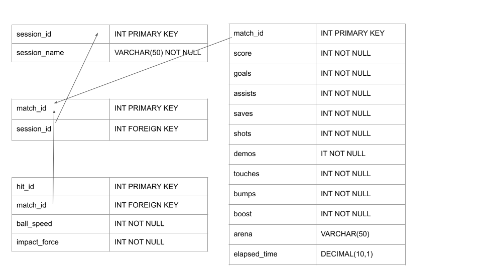

# Rocket League Full Stack Project

##### The purpose of this project is to show you your stats while you are in a game of Rocket League, as if you expanded the custom scoreboard added in season 24. It also tells you the speed and impact force of the ball when you hit the crossbar.

### Use Cases
As a player, I need to be able to see my stats

As a player, I need to be able to see my match info

As a player, I need to be able to see my session info

As a player, I need to be able to play to input my stats

As a viewer, I need to be able to view players stats

### Business Rules
#### Structural Rules
A player must have a username

A player must be in a match

A player must be in a session
#### Integrity Constraints
You cannot share a username with other people

#### Derivation Rules
A stat is counted when the Rocket League API counts them

