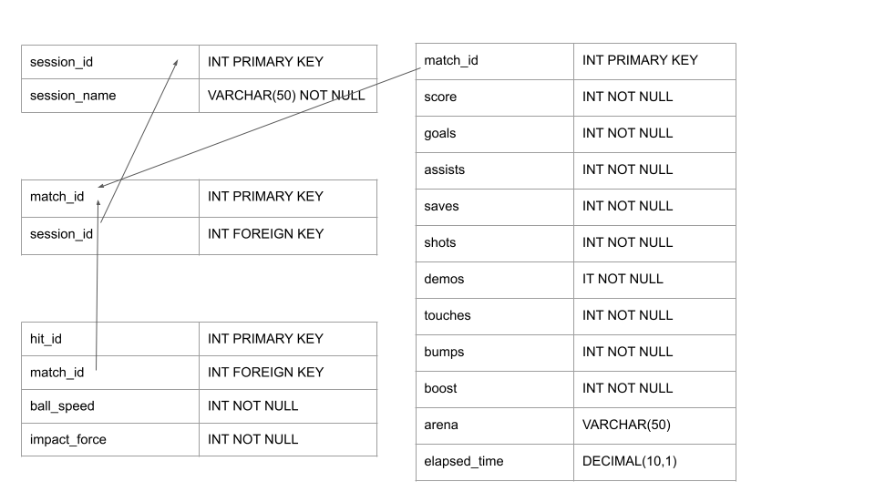

# Use Cases
As a player, I need to be able to see my stats

As a player, I need to be able to see my match info

As a player, I need to be able to see my session info

As a player, I need to be able to play to input my stats

As a viewer, I need to be able to view players stats

# Business Rules
## Structural Rules
A player must have a username

A player must be in a match

A player must be in a session

## Integrity Constraints
You cannot share a username with other people

## Derivation Rules
A stat counter is increased when that stat is achieved in game according to the live Rocket League API

